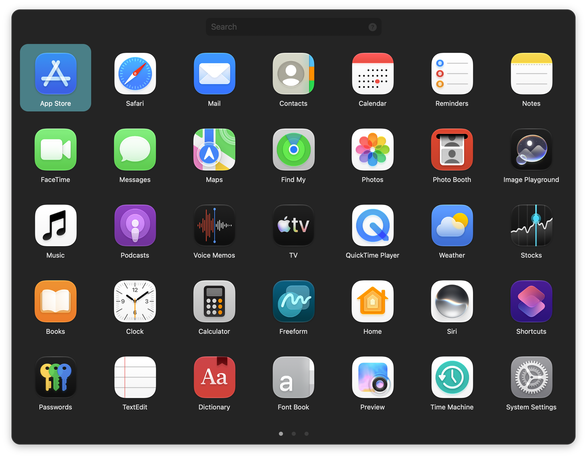

#  Launchpad Alfred Workflow

Open apps from a customisable grid

[⤓ Install on the Alfred Gallery](https://alfred.app/workflows/alfredapp/launchpad)

## Usage

Show a grid of apps to open via the `launchpad` keyword.

Type to filter, use the arrow keys to move and <kbd>↩&#xFE0E;</kbd> to open. Rearranging apps is keyboard-based too.

Click the `?` in the search bar or press <kbd>⌘</kbd><kbd>?</kbd> to view the cheat sheet.

Configure the [Hotkey](https://www.alfredapp.com/help/workflows/triggers/hotkey/) for faster triggering.
